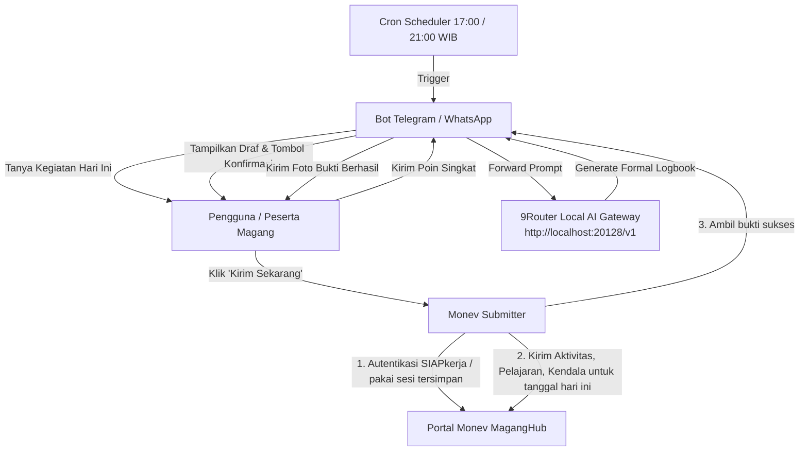

# 🤖 MagangHub Auto-Attendance & AI Logbook Bot

Sistem otomasi presensi dan pengisian *logbook* harian untuk platform **Monev MagangHub Kemnaker** ([monev.maganghub.kemnaker.go.id](https://monev.maganghub.kemnaker.go.id)) berbasis chat bot (Telegram / WhatsApp) yang terintegrasi dengan **9Router AI**, ditulis dalam **Go** agar ringan dijalankan di VPS (satu binary statis tanpa cgo, RAM idle puluhan MB).

---

## 📌 Latar Belakang & Masalah
Peserta Program Pemagangan Nasional Kemnaker wajib mengisi presensi dan laporan aktivitas harian di portal Monev sebelum pukul **23.59 WIB**. 
Laporan harian mensyaratkan 3 komponen utama dengan ketentuan panjang karakter tertentu:
1. **Uraian Aktivitas** (kegiatan yang dilakukan, min. 100 karakter)
2. **Pelajaran yang Diperoleh** (insight/skill baru)
3. **Kendala yang Dihadapi** (hambatan kerja atau solusinya)

Keterlambatan atau lupa mengisi absensi berakibat status dianggap **alpa / tidak hadir**, yang berdampak langsung pada pencairan uang saku dan evaluasi mentor.

---

## 🚀 Fitur Utama

- ⏰ **Pengingat Otomatis (Daily Reminder)**: Mengirim notifikasi pengingat ke Telegram/WA setiap sore (misal: 17:00 & 21:00 WIB) jika belum absen.
- 💬 **Interaktif lewat Chat**: Cukup ketik poin-poin singkat kegiatan harian santai lewat chat.
- 🧠 **AI Paraphraser (via 9Router)**: Mengubah catatan singkat menjadi kalimat profesional, formal, dan memenuhi batas minimal karakter (100+ karakter) sesuai standar Monev Kemnaker.
- 📋 **Preview & Konfirmasi**: Menampilkan draf laporan ke pengguna sebelum disubmit (bisa minta revisi atau langsung *Approve*).
- 🌐 **Pengiriman ke Monev**: Diutamakan lewat API Monev langsung (tanpa browser, paling ringan). Jika tidak memungkinkan, browser headless hanya dinyalakan saat submit lalu ditutup.
- 📸 **Bukti Eksekusi**: Mengirim konfirmasi sukses (atau screenshot kalender hijau bila memakai browser) langsung ke chat pengguna.

---

## 🏗️ Alur Sistem (Workflow)



---

## 🗂️ Struktur Direktori

```text
auto-attendance/
├── README.md
├── go.mod / go.sum
├── .env.example               # Contoh environment variables
├── storage_state/             # Sesi WhatsApp & SIAPkerja (persistent, tidak di-commit)
├── cmd/bot/main.go            # Entry point aplikasi
└── internal/
    ├── config/config.go       # Validasi dan konfigurasi env
    ├── bot/
    │   ├── flow.go            # State machine chat, tidak bergantung channel
    │   ├── telegram.go        # Adapter Telegram (tombol inline)
    │   └── whatsapp.go        # Adapter WhatsApp via whatsmeow (balasan 1/2/3)
    ├── ai/
    │   ├── client.go          # Client OpenAI-compatible ke 9Router (net/http, tanpa SDK)
    │   └── prompt.go          # System prompt, struct & validasi logbook
    ├── monev/submitter.go     # Interface pengiriman ke Monev (implementasi menyusul)
    └── scheduler/scheduler.go # Pengingat jadwal harian (cron, zona Asia/Jakarta)
```

Dependensi utama: `go-telegram/bot`, `go.mau.fi/whatsmeow`, `modernc.org/sqlite` (SQLite pure Go untuk sesi WA), `robfig/cron/v3`, `joho/godotenv`.

---

## ▶️ Menjalankan

```bash
cp .env.example .env   # isi minimal satu channel: Telegram dan/atau WhatsApp
go run ./cmd/bot
```

Build untuk VPS Linux (dari Mac pun bisa, hasilnya satu file):

```bash
GOOS=linux GOARCH=amd64 CGO_ENABLED=0 go build -ldflags="-s -w" -o bin/bot ./cmd/bot
```

Telegram dan WhatsApp bisa aktif bersamaan. Keduanya memakai satu draf yang sama: pengingat dikirim ke semua channel aktif, dan balasan dikirim ke channel tempat kamu mengetik.

Perintah (di WhatsApp boleh tanpa `/`): `isi` mulai isi logbook, `status` cek status hari ini, `batal` batalkan draf. Saat draf tampil, pilih Kirim/Revisi/Batal (tombol di Telegram, balas `1`/`2`/`3` di WhatsApp) atau langsung ketik instruksi revisi.

### 📱 WhatsApp (whatsmeow)

> ⚠️ whatsmeow adalah klien WhatsApp **tidak resmi**. Nomor yang dipakai bot berisiko diblokir, jadi gunakan **nomor kedua** untuk bot, bukan nomor utama.

- `WA_ALLOWED_NUMBER` adalah nomor **kamu** (satu-satunya yang dilayani). Nomor bot harus berbeda.
- Login pertama kali: jalankan bot di terminal, lalu scan QR yang muncul dari HP nomor bot (*Perangkat tertaut > Tautkan perangkat*). Di VPS tanpa layar, isi `WA_BOT_NUMBER` untuk mendapat **kode tautan 8 karakter** di log sebagai ganti QR.
- Sesi tersimpan di `WA_SESSION_DB` (default `storage_state/whatsapp.db`), jadi restart tidak perlu login lagi. Bila logout dari HP, hapus file itu lalu login ulang.

> Catatan: status "sudah terkirim hari ini" masih disimpan di memori, jadi hilang bila bot di-restart.

---

## 🧠 Desain Prompt AI (9Router)

Model AI diarahkan untuk merangkum input santai menjadi tiga kolom berstandar Kemnaker:

```markdown
### SYSTEM PROMPT TEMPLATE:
Kamu adalah asisten profesional yang bertugas menyusun laporan harian (logbook) 
peserta Program Pemagangan Nasional Kemnaker RI.

Diberikan catatan singkat kegiatan pengguna, ubah menjadi format JSON:
{
  "aktivitas": "Penjelasan detail kegiatan kerja harian. Bahasa baku, profesional, dan minimal 100 karakter.",
  "pembelajaran": "Keterampilan teknis, wawasan bisnis, atau soft skill baru yang dipelajari hari ini.",
  "kendala": "Hambatan atau tantangan yang dihadapi serta solusi penyelesaiannya (jika tidak ada kendala, jelaskan adaptasi alur kerja berjalan lancar)."
}
```

---

## ⚙️ Variabel Lingkungan (`.env`)

```ini
# Telegram (aktif bila token diisi)
TELEGRAM_BOT_TOKEN="your_telegram_bot_token"
TELEGRAM_ALLOWED_USER_ID="your_telegram_numeric_id"

# WhatsApp via whatsmeow
WA_ENABLED=false
WA_ALLOWED_NUMBER="081234567890"   # nomor KAMU; 08xx otomatis jadi 628xx
WA_BOT_NUMBER=""                   # opsional: nomor bot, untuk login pakai kode tautan
WA_SESSION_DB="storage_state/whatsapp.db"

# 9Router AI Gateway Configuration
ROUTER_BASE_URL="http://localhost:20128/v1"
ROUTER_API_KEY="sk-dummy-or-your-key"
AI_MODEL_NAME="gpt-4o-mini" # atau model favorit di 9router

# Akun Kemnaker SIAPkerja
SIAPKERJA_EMAIL="email_kamu@domain.com"
SIAPKERJA_PASSWORD="password_kamu"

# Jadwal pengingat (HH:MM, dipisah koma) dan zona waktunya
REMINDER_TIMES="17:00,21:00"
TZ_LOCATION="Asia/Jakarta"
```

---

## 📋 Langkah Implementasi Bertahap

- [x] **Fase 1: Setup 9Router Client**
  - Client OpenAI-compatible dengan validasi JSON & minimal 100 karakter (retry otomatis 1x).
  - [ ] Uji langsung terhadap service `9router` di `http://localhost:20128/v1`.
- [ ] **Fase 2: Pengiriman ke MagangHub**
  - Petakan request Monev lewat DevTools > Network (Fetch/XHR) saat menyimpan logbook.
  - Jika ada API JSON: implementasikan `monev.Submitter` dengan HTTP biasa + simpan token sesi.
  - Jika tidak: browser headless on-demand (`chromedp`), hanya hidup saat submit.
- [x] **Fase 3: Integrasi Bot Telegram & WhatsApp**
  - State machine chat: *Tanya Kegiatan -> AI Draft -> Konfirmasi/Revisi -> Eksekusi*.
  - [ ] Uji langsung dengan akun Telegram & nomor WA sungguhan.
- [ ] **Fase 4: Penjadwalan & Testing**
  - [x] Cron pengingat 17:00 & 21:00 WIB (dilewati jika sudah terkirim).
  - [ ] Uji coba akhir (end-to-end test).

